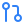
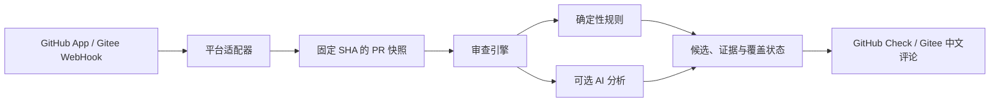

<p align="center">
  
</p>

<h1 align="center">Evidence Review Bot</h1>

<p align="center">
  开源 PR 审查引擎<br>
  <strong>确定性规则 · 可追溯证据 · 审查覆盖率 · 可选 AI 分析</strong>
</p>

<p align="center">
  <a href="LICENSE"></a>
  <a href="https://github.com/ACatNight/evidence-review-bot/actions/workflows/quality.yml?query=branch%3Agithub"></a>
  <a href="package.json"></a>
  <a href="tsconfig.json"></a>
</p>

<p align="center">
  <a href="https://github.com/ACatNight/evidence-review-bot/tree/github"></a>
  <a href="https://gitee.com/mournic/evidence-review-bot/tree/gitee"></a>
</p>

<p align="center">
  <a href="#快速体验">快速体验</a> ·
  <a href="#本地审查">本地审查</a> ·
  <a href="#当前能力">当前能力</a> ·
  <a href="#接入真实-pr">接入指南</a> ·
  <a href="#开发与验证">本地开发</a> ·
  <a href="#参与项目">参与项目</a>
</p>

---

Evidence Review Bot 接收平台的 PR 事件，读取固定提交的变更快照，执行审查，并将结果发布回代码托管平台。报告会说明**检查了什么、发现了什么、哪些范围没有完成**。项目正在测试仓库阶段，适合评估报告方式和联调流程；检测效果与生产运行能力尚未经过充分验证。

<table>
  <tr>
    <td width="50%" valign="top">
      
      <strong>确定性规则</strong><br>
      从明确的凭据格式规则开始，记录匹配位置与脱敏候选。
    </td>
    <td width="50%" valign="top">
      
      <strong>证据与快照</strong><br>
      结果绑定具体提交，保留规则、代码位置和证据来源。
    </td>
  </tr>
  <tr>
    <td width="50%" valign="top">
      
      <strong>审查覆盖率</strong><br>
      明确展示已检查范围、部分完成原因与未运行的检查。
    </td>
    <td width="50%" valign="top">
      
      <strong>平台接入</strong><br>
      GitHub Check 与 Gitee 中文 PR 评论，共用审查核心。
    </td>
  </tr>
</table>

## 快速体验

无需数据库、平台账号或 AI 密钥，就能先查看报告格式。需要 Node.js **22.22.2** 和 npm：

```bash
git clone --branch github https://github.com/ACatNight/evidence-review-bot.git
cd evidence-review-bot
npm ci
npm run demo:report -- github
npm run demo:report -- gitee
```

这两个命令生成**离线合成报告**：不读取真实仓库代码，不执行扫描，不连接数据库或模型，也不会发布评论。报告展示候选问题、审查覆盖率、未检查范围和未运行的检查；不能用来判断检测准确率。真实接入请按下方的[接入步骤](#接入真实-pr)操作。

## 本地审查

本地扫描需要 Git，无需数据库、平台账号或 AI 密钥。安装依赖后，在本工具目录运行；用 `--repo` 指定你自己的项目：

```bash
npm run review -- scan --repo ../my-project --staged
npm run review -- scan --repo ../my-project --head WORKTREE
npm run review -- scan --repo ../my-project --base origin/main --head HEAD
```

| 使用场景 | 选项 | 实际读取内容 |
| --- | --- | --- |
| 提交前检查 | `--staged` | 暂存区相对 `HEAD` 的变化；之后的未暂存修改不参与 |
| 开发中检查 | `--head WORKTREE` | 工作区相对 `HEAD` 的变化；只含已跟踪或已暂存文件 |
| 分支比较 | `--base origin/main --head HEAD` | 从两个提交的 merge-base 到目标提交的变化 |

未跟踪文件需先 `git add`。省略 `--repo` 时检查当前目录；省略所有范围选项时比较 `HEAD~1` 和 `HEAD`。首次提交之后可用 `--staged` 或 `--head WORKTREE`；尚无提交的空仓库需先创建初始提交。本地扫描只处理新增和修改文件，不处理删除文件。

文本报告默认中文，用 `--lang en` 切换英文。导出 JSON 报告用于其他工具或 CI：

```bash
npm run --silent review -- scan --repo ../my-project --staged --format json --output reports/review.json
```

`--output` 相对**运行命令的目录**，会自动创建父目录；已有文件默认拒绝覆盖，确需替换时加 `--force`。省略 `--output` 时报告写入标准输出。使用 `npm run --silent review` 可避免 npm 提示混入 JSON，构建错误和运行诊断写入标准错误。重复扫描可先运行 `npm run build`，再直接调用 `node dist/src/entrypoints/cli.js scan ...`，省去每次构建。

每次最多处理 50 个文件，每个文本文件最多 256 KB，超限范围标记为未完成。此入口仅执行 SEC-001，不调用模型、不启动目标项目的 Lint、构建或测试。扫描期间请避免同时修改工作区或暂存区，以免读取不同时间的内容。

退出码：`0` 无候选（空范围会标记 `not_run`），`1` 有候选，`2` 参数错误，`3` 覆盖不完整，`4` 执行失败。只有已执行检查的范围可据此判断；返回 `0` 不代表代码安全。npm 包尚未发布，当前使用仓库内的命令入口。

常见问题：找不到基准分支时先 `git fetch`；CI 中缺少共同历史时使用完整检出（例如 `fetch-depth: 0`）；存在合并冲突时先解决冲突并暂存。`npm run review -- --help` 可查看全部参数。

## 当前能力

| 能力 | 当前状态 | 边界 |
| --- | --- | --- |
| GitHub PR 自动审查 | 已实现测试仓库链路 | GitHub App Webhook、固定 SHA 快照、Check 汇总 |
| Gitee PR 自动审查 | 已实现测试仓库链路 | 仓库 WebHook、固定 SHA 快照、中文 PR 评论报告 |
| 确定性规则 SEC-001 | 已实现 | 仅匹配指定 GitHub Token 与 PEM 格式；不验证凭据有效性 |
| AI 安全审查 | 可选，默认关闭 | 仅对授权仓库发送尽力脱敏的变更代码；输出是待人工核实的候选 |
| 审查覆盖率 | 已显示 | 区分已检查、部分完成和未运行；覆盖率不是安全评分或检出率 |
| Lint、构建、测试、依赖审计 | 机器人尚未执行 | 本仓库的 CI 独立运行这些检查，结果不代表目标 PR 已被机器人检查 |
| GitLab、反馈、抑制、回放、完整审计 | 规划中 | 当前没有可供用户启用的实现 |

**零条候选不等于代码安全。** 文件读取失败、超出限制、AI 调用失败和未运行的检查会在报告中体现。SEC-001 目前识别 GitHub 经典令牌、fine-grained PAT 和部分 PEM 私钥格式，仅报告涉及本次变更行的候选；其他服务密钥、普通密码和复杂 PEM 变体可能漏报。完整匹配条件见[规则实现](src/rules/secret.ts)。

## 工作方式



平台接入、任务处理和报告发布分别实现；领域契约与覆盖计算位于 `src/domain/`，规则位于 `src/rules/`。报告绑定具体提交，并在发布前核对 PR 状态，避免把旧快照的结果误当成当前结果。

## 接入真实 PR

当前可操作的部署路径是 **Windows 本机试点**。需要 PostgreSQL、Node.js、可供平台访问的 HTTPS Webhook 地址，以及所选平台的授权资料。首次配置后，脚本可构建、迁移并启动 API 与 Worker；它不会代建平台应用、数据库或公网入口。Docker Compose、跨平台安装器和管理界面尚未提供。

准备以下资料，并将密钥文件保存在仓库外：

| 配置 | 需要填写 |
| --- | --- |
| 数据库 | 已创建的 PostgreSQL 数据库连接地址，以及单独保存的密码文件 |
| GitHub App | App ID、私钥文件、与平台一致的 Webhook Secret 文件 |
| Review HMAC | 至少 32 字节随机密钥的十六进制文件内容，启动时保持不变 |
| 公网入口 | HTTPS 地址；使用 ngrok 时另填客户端路径、固定域名和令牌文件 |
| Gitee（可选） | 私人令牌文件、仓库所有者与名称、数字 ID、Webhook 密钥文件 |

在仓库根目录运行配置向导，再启动服务：

```powershell
powershell -NoProfile -File .\scripts\configure-windows.ps1
powershell -NoProfile -File .\scripts\start-windows.ps1
```

配置保存在仓库外，仅记录密钥路径。需要更改保存目录时，先设置 `EVIDENCE_REVIEW_BOT_HOME`。停止服务使用 `powershell -NoProfile -File .\scripts\stop-windows.ps1`。

GitHub App 需安装到目标仓库，仓库权限设置为 `Contents: Read-only`、`Pull requests: Read-only`、`Checks: Read and write`，订阅 `Pull request` 事件，回调地址填写 `https://你的域名/webhooks/github`。

Gitee 在目标仓库「管理 → WebHooks」订阅 Pull Request，地址填写 `https://你的域名/webhooks/gitee`，优先选择签名密钥方式；私人令牌需能读取仓库和发布 PR 评论。当前启动脚本和 Worker 仍要求 GitHub App 配置，**仅接 Gitee 的部署尚不能独立完成**。

启动后检查 `/healthz`，再创建测试 PR，依次确认平台投递记录、任务执行和报告发布。本机及公网入口需要持续运行，关机后自动审查停止。

AI 审查可在配置向导中单独开启，需要模型服务、密钥文件和允许传输代码的仓库清单。代码仅做尽力脱敏，启用前应确认允许发送到所选服务；模型输出仍需人工核实。

## 开发与验证

```bash
npm ci
npm run lint
npm run check
npm test
```

一次性执行本地质量门禁可使用 `npm run verify`，它依次运行格式检查、Lint、类型检查和测试。依赖漏洞检查使用 `npm run audit`，只读取锁文件，不安装或执行项目脚本。

`npm test` 会构建项目并运行测试；数据库集成测试需设置 `TEST_DATABASE_URL`，指向名为 `evidence_review_bot_test` 的专用 PostgreSQL 数据库。测试会清理该库的测试数据，请勿使用业务数据库。本仓库的 GitHub Actions 还运行 npm 依赖审计和 CodeQL。这些是**项目自身的质量检查**，不是对接入仓库的 PR 执行的检查。

## 参与项目

欢迎通过 Issue 提供可复现的错误、部署问题和测试仓库反馈。提交代码前请运行上面的本地检查；涉及检测规则的改动应同时说明正例、反例、误报边界和覆盖变化。安全问题请避免在公开 Issue 中粘贴真实凭据或私有代码。

## 许可证

本项目采用 [Apache License 2.0](LICENSE)。

README 图标来自 [Lucide](https://lucide.dev/)，徽章由 [Shields.io](https://shields.io/) 与 GitHub Actions 提供，技术标识来自 [Simple Icons](https://simpleicons.org/)。图标来源、改动和许可证见[资源说明](docs/assets/README.md)。
